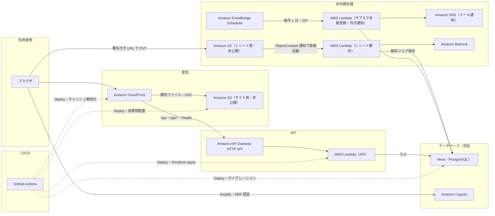

# KakeiboApp

## 概要

個人用の家計簿 Web アプリです。月ごとの収支を記録・集計し、月額サブスクの自動登録やレシート画像からの入力候補作成で、日々の入力を補助します。

機能の詳細は [要件定義](docs/requirements.md) を参照してください。

## 機能一覧

- Cognito ログイン
- 収支の登録・一覧表示・編集・削除（月単位、前後月の切り替え）
- プリセットカテゴリ（支出 11 種・収入 3 種）
- 月次集計（収入・支出の合計、差額、カテゴリ別構成比）
- 月額サブスク管理と月初のサブスク自動登録
- 前月の月次集計メール通知
- レシート画像からの登録候補作成（内容を確認してから手動登録）

## 技術スタック

| 領域 | 使用技術 |
|---|---|
| フロントエンド | React 18、TypeScript、Vite、React Router、AWS Amplify |
| API | .NET 10 Minimal API、EF Core、Npgsql |
| データベース | PostgreSQL 18（ローカル・CI）、Neon（本番構成） |
| インフラ | AWS、Terraform 1.17.1、Docker Compose |
| テスト | xUnit、WebApplicationFactory、Vitest、Testing Library |
| CI/CD | GitHub Actions |

## アーキテクチャ図



ブラウザは CloudFront 経由で静的ファイルと API にアクセスします。静的ファイルには CloudFront Function による SPA フォールバックを使います。認証はブラウザから Cognito に直接行い、API Lambda がアクセストークンを検証します。

レシートは API から取得した署名付き URL で S3 に直接アップロードします。S3 のイベント通知が解析 Lambda を直接起動し、Bedrock の解析結果を DB に保存します。ブラウザは API を 2 秒間隔で確認し、新規フォームへ結果を反映します。EventBridge Scheduler はレシート解析には介在せず、毎月 1 日の 0:05 JST にサブスク自動登録、0:10 JST に前月集計メール通知を起動します。

図の破線はデプロイ時の経路です。構成と運用の詳細は [デプロイ手順](docs/deployment.md) を参照してください。

## 工夫した点

### コスト削減の工夫

個人利用に向けた最小コスト構成です。無料枠の利用だけで費用がなくなる構成ではなく、Secrets Manager の固定費や CloudWatch Logs、CloudFront のキャッシュ無効化、Terraform state のバージョン保存などにも費用が発生します。

- **サーバーレス構成**: API とバッチを Lambda で実行します。常時起動するアプリサーバーを持たず、リクエストや実行時間に応じた課金に寄せるためです。
- **VPC・NAT を使わない構成**: Lambda から Neon へインターネット経由で TLS 接続します。NAT Gateway の維持費を持たないためです。
- **Neon の無料枠**: 無料枠の範囲内なら DB の費用を抑えられます。一定時間で休止するため、復帰時の初回アクセスには待ち時間があり、API Lambda のタイムアウトは 25 秒としています。
- **API Gateway HTTP API**: HTTP API を採用しています。一般論として REST API より低コストで API を公開できる選択肢です。この説明は料金体系の一般的な比較であり、本アプリの実測値ではありません。
- **S3 ライフサイクル（7 日）**: レシート画像と未完了マルチパートアップロードを 7 日で削除し、保存量の増加を抑えます。解析ジョブの行は保持します。
- **Bedrock（従量課金）**: レシート解析時にモデルを呼び出し、利用量に応じて課金される方式を使います。推論用サーバーを常時維持する費用を持たないためです。

### セキュリティの工夫

- **Cognito 認証**: API 側で JWT の署名・発行者・有効期限・`token_use=access`・`client_id` を検証します。`GET /health` は匿名アクセスを許可し、`/api/*` は認証必須にすることで API を保護します。
- **サインアップの無効化**: Cognito の自己登録を禁止し、管理者がユーザーを作成します。個人用アプリへの第三者の登録を防ぐためです。
- **OIDC によるデプロイ**: GitHub Actions から AWS への認証に長期アクセスキーを使わず、承認されたデプロイでロールを引き受けます。長期キーの保管を避けるためです。
- **最小権限の IAM**: 対象リソースを限定し、デプロイロール自身への直接の権限昇格を Deny で拒否します。apply 前にも権限をシミュレーションし、意図しない権限操作を抑えます。詳細と制約は [デプロイ権限の正本](infra/iam/README.md) にまとめています。
- **非公開 S3**: サイト用・レシート用ともにパブリックアクセスをブロックします。サイト用の読み取りは CloudFront OAC に限定し、レシート用は署名付き URL でアップロードすることで公開を避けます。

認証の詳細は [認証の設定と確認手順](docs/authentication.md) を参照してください。

### その他の工夫

- レシート解析結果は自動登録せず、フォーム上で人間が確認して登録します。解析誤りをそのまま収支に反映させないためです。
- DB は API 用ロールの権限を限定し、本番では起動時マイグレーションを無効にします。スキーマ変更をデプロイ工程で扱うためです。
- フロント成果物に DB 接続情報が混入していないか、デプロイ時に検査します。ブラウザへの秘密情報の配布を防ぐためです。

接続文字列は Secrets Manager に保存しますが、Terraform が Lambda 環境変数へ注入するため Terraform state にも含まれます。state の保護が必要という制約があります。

## CI/CD

GitHub Actions の [CI](.github/workflows/ci.yml) は、PR の変更パスに応じてフロントエンド・API・インフラの検証と actionlint を実行し、`ci-result` で結果を集約します。main への push では全ジョブを実行します。README のみの変更ではフロントエンド・API・インフラの検証は対象外となるため、文書の内容は別途確認します。

[Deploy](.github/workflows/deploy.yml) は CI 成功後に起動します。最新コミットの確認と `production` Environment の人間承認を経て、マイグレーション、Lambda のパッケージ作成、Terraform plan の保存、IAM プリフライト、保存した plan の apply を行います。その後、フロントをビルド・検査し、S3 へアセットを先に、`index.html` を最後に配置して CloudFront のキャッシュを無効化します。

自動ロールバックはありません。詳細な運用手順は [デプロイ手順](docs/deployment.md) にまとめています。

## 開発の進め方

1 Issue = 1 Worktree = 1 ブランチ = 1 PR の Issue 駆動で開発します。AI エージェントの役割を分け、計画・実装・独立レビューを引き継ぎます。

| 担当 | 役割 |
|---|---|
| Codex | 要件の具体化、Issue・Worktree 作成、TDD による実装・検証、承認済み指摘の修正、push・Draft PR 作成、CI 確認 |
| Claude Code | 実装計画・テスト計画の作成、独立レビュー |
| Muse | 起動・進行管理 |
| 人間 | 要望提示、要件（H1）・計画（H2）・修正対象（H3）・PR とマージ（H4）の承認、マージ |

TDD は Red → Green → Refactor の順に進めます。詳細は [開発フロー](docs/workflow.md) を参照してください。

## ローカルでの起動方法

Docker Compose を使います。ホストへの .NET・Node のインストールは不要です。

```sh
cp .env.example .env
```

`.env` の `POSTGRES_PASSWORD` を設定してから起動します。空のままでは起動できません。

```sh
docker compose up -d
```

フロントエンドは http://localhost:5173 、API は http://localhost:8080 です。

`COGNITO_*` が空でもプレースホルダで起動しますが、ログインはできません。実際にログインするには Cognito の実値と管理者が作成したユーザーが必要です。ローカル用 Cognito モックはありません。設定は [認証の設定と確認手順](docs/authentication.md) を参照してください。

テストは次のコマンドで実行します。API テストにはテスト用 PostgreSQL が必要で、テストクラスごとに専用 DB を作成します。

```sh
docker compose run --rm api dotnet test Kakeibo.slnx
docker compose run --rm --no-deps frontend sh -c "npm ci && npm test"
```

lint・format とフロントエンドの型チェックは次のコマンドです。

```sh
docker compose run --rm --no-deps api dotnet format Kakeibo.slnx --verify-no-changes
docker compose run --rm --no-deps frontend sh -c "npm ci && npm run lint"
docker compose run --rm --no-deps frontend sh -c "npm ci && npx tsc --noEmit"
```

## ディレクトリ構成

| パス | 内容 |
|---|---|
| [api/](api/) | API のエンドポイント、サービス、モデル、DB・マイグレーション、認証 |
| [api/batch/](api/batch/) | 月次バッチ・レシート解析 Lambda |
| [api/tests/](api/tests/) | API・バッチのテスト |
| [frontend/src/](frontend/src/) | API 通信、認証、コンポーネント、ドメイン、フック、ページ |
| [infra/](infra/) | Terraform、IAM、スクリプト、テスト、CloudFront Function |
| [docs/](docs/) | 要件・認証・デプロイ・開発フローの説明 |
| [.github/workflows/](.github/workflows/) | CI・デプロイのワークフロー |
| [scripts/review/](scripts/review/) | レビュー用スクリプト |
| [docker-compose.yml](docker-compose.yml) | ローカル開発環境の定義 |
